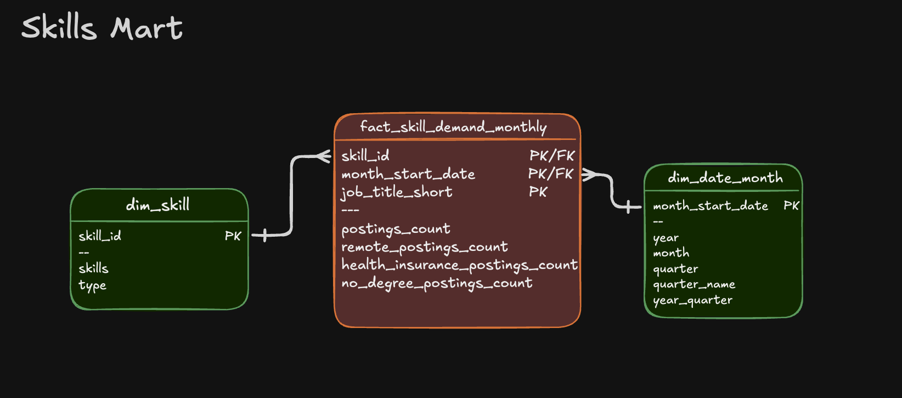

# Job Postings Data Pipeline: GCS → Star Schema DW → Analytical Marts

An end-to-end Data Engineering project: raw CSV files stored on Google Cloud Storage are loaded into a normalized star-schema data warehouse, on top of which specialized data marts are built for analytics.


## Executive Summary

- **Pipeline scope:** complete ETL pipeline from raw CSVs to a star-schema warehouse to analytical marts.
- **Data modeling:** star schema with fact, dimension and bridge tables.
- **ETL development:** idempotent extract-load-transform process with data quality checks.
- **Mart architecture:** specialized marts (flat, skills, priority) with additive measures and incremental update patterns.

## Problem & Context

The data arrives as raw CSV files on Google Cloud Storage, not structured for analysis. Analysts want to answer questions such as:

- Which skills are most in demand over time?
- What are the hiring trends of companies?
- How do salary patterns vary by skill and role?

**The challenge:** multiple teams need a single source of truth, but each performs different analyses depending on its goals. Dedicated data marts are therefore needed to make queries simpler and more efficient.

**The solution:** an end-to-end pipeline that extracts the data from the CSVs, loads it into a data warehouse following a star schema (separating facts from dimensions), and then builds purpose-specific data marts.

## Tech Stack

| Area | Tool |
|---|---|
| 🐤 Database | DuckDB (file-based OLAP database with GCS integration via `httpfs`) |
| 🧮 Language | SQL (DDL for schema design, DML for loading and transformation) |
| 📊 Data model | Star schema (fact + dimension + bridge tables) |
| 🛠️ Development | VS Code for SQL editing + terminal for DuckDB CLI execution |
| 🔧 Automation | Master SQL script for pipeline orchestration |
| 📦 Version control | Git / GitHub |
| ☁️ Storage | Google Cloud Storage (source CSV files) |

## Repository Structure

```text
├── 1_create_tables_dw.sql        # initial star schema creation
├── 2_load_schema_dw.sql          # extract & load data from GCS
├── 3_create_flat_mart.sql        # flat (denormalized) mart
├── 4_create_skills_mart.sql      # skills demand mart
├── 5_create_priority_mart.sql    # priority roles mart
├── 6_update_priority_mart.sql    # priority mart incremental update (MERGE)
├── build_marts.sql               # master SQL build script
└── README.md                     # you are here
```

## Pipeline Architecture

The pipeline takes the job posting CSVs from GCS and transforms them into a normalized star-schema warehouse. Specialized marts are then built on top of it. Both the warehouse and the marts can be consumed by BI tools.

 

### Data Warehouse

The warehouse implements a star schema using `company_dim`, `skills_dim`, `job_postings_fact` and `skills_job_dim`.

 

- **SQL files:**
  - `1_create_tables_dw.sql`: defines the star schema (4 core tables)
  - `2_load_schema_dw.sql`: extracts CSVs from GCS and loads them into the warehouse tables
- **Purpose:** single source of truth for analytical queries
- **Grain:** one row per job posting in the fact table (`job_postings_fact`)

### Flat Mart

Denormalized table with all dimensions, for ad-hoc queries.


- **SQL file:** `3_create_flat_mart.sql`
- **Purpose:** quick ad-hoc queries without joins
- **Grain:** one row per job posting, all dimensions joined

### Skills Mart

Time-series analysis of skill demand with additive measures.

  

- **SQL file:** `4_create_skills_mart.sql`
- **Purpose:** analyze skill demand over time
- **Grain:** `skill_id` + `month_start_date` + `job_title_short`
- **Key feature:** all measures are additive (counts/sums), so they can be safely re-aggregated

### Priority Mart

Priority role tracking with incremental updates via `MERGE`.

  

- **SQL files:**
  - `5_create_priority_mart.sql`: initial build of priority roles and jobs snapshot
  - `6_update_priority_mart.sql`: incremental update using `MERGE` (upsert pattern)
- **Purpose:** track priority roles and job snapshots with incremental update capabilities
- **Grain:** one row per job posting with a priority level assigned
- **Key feature:** `MERGE` handles INSERT, UPDATE and DELETE in a single statement, a production-ready upsert pattern

## 💻 Data Engineering Skills Demonstrated

### ETL Pipeline Development
- **Extract:** direct CSV loading from Google Cloud Storage via DuckDB's `httpfs` extension
- **Transform:** data normalization, type conversion (`CAST`, `DATE_TRUNC`) and quality filtering
- **Load:** idempotent table creation with `DROP TABLE IF EXISTS` patterns
- **Incremental updates:** `MERGE` operations for upserts (INSERT, UPDATE, DELETE in a single statement)
- **Orchestration:** master SQL script (`build_marts.sql`) for automated pipeline execution

### Dimensional Modeling
- **Star schema design:** fact table (`job_postings_fact`) with dimension tables (`company_dim`, `skills_dim`)
- **Bridge tables:** many-to-many relationships (`skills_job_dim`, `bridge_company_location`, `bridge_job_title`)
- **Grain definition:** proper fact table granularity (skill + month, company + title + location + month)
- **Additive measures:** counts and sums that can be safely re-aggregated at any level

### Advanced SQL Techniques
- **DDL:** `CREATE TABLE`, `DROP TABLE`, `CREATE SCHEMA` for schema management
- **DML:** `INSERT INTO ... SELECT` with explicit column mapping from CSV sources
- **MERGE:** `MERGE INTO` with `WHEN MATCHED`, `WHEN NOT MATCHED` and `WHEN NOT MATCHED BY SOURCE` clauses
- **CTEs:** complex transformations and boolean flag conversions
- **Date functions:** `DATE_TRUNC('month')`, `EXTRACT(quarter)` for temporal dimensions
- **String functions:** `STRING_AGG` for concatenation, `REPLACE` for data cleaning
- **Boolean logic:** `CASE WHEN` conversions for aggregating flags (remote, health insurance, no degree)

### Data Quality & Production Practices
- **Idempotency:** all scripts can be safely re-run without side effects
- **Data validation:** verification queries at each pipeline step to ensure data integrity
- **Type safety:** explicit data types (`VARCHAR`, `INTEGER`, `DOUBLE`, `BOOLEAN`, `TIMESTAMP`)
- **Schema organization:** separate schemas (`flat_mart`, `skills_mart`, `priority_mart`, `company_mart`) for logical separation
